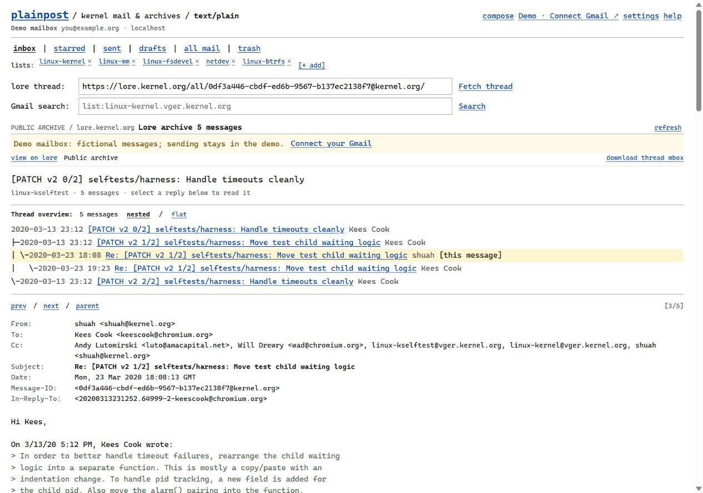

# Plainpost

A standalone, keyboard-driven Gmail IMAP/SMTP client and public lore reader for Linux kernel mailing lists. The interface follows lore's compact, monospace layout: an ASCII reply tree, one selected message, full headers, and parent/previous/next navigation. The composer sends **only `text/plain; charset=UTF-8`**. Gmail uses a Mutt-style home config and app password by default; no Google Cloud project is needed. No build step or database service is required.



## Run locally

Requires Git to clone the source and **Node.js 22 or newer** with npm. Runs on Linux (including ARM64), macOS, and Windows.

```sh
git clone https://github.com/DhruvaG2000/plainpost.git
cd plainpost
npm ci --ignore-scripts
npm start
```

Open **http://localhost:4819**. Choose **Explore demo** to try fictional mailing-list conversations without credentials. Demo sends stay in memory and never contact Google or any recipient. Restarting the server resets the demo.

Use `npm start`, `npm run dev`, and `npm test` to serve, develop, and test. Dependencies are ImapFlow, Nodemailer and Mailparser, pinned in the lockfile; no native compilation is required.

[Windows Chrome verification](docs/chrome-qa.md) records the tested WSL access, live lore import, demo mailbox flows, responsive layout, screenshots and remaining Gmail setup requirements.

## Run from Ubuntu WSL

Clone Plainpost into your WSL home directory and run these commands in Ubuntu:

```sh
cd ~/plainpost
sh scripts/setup-linux.sh
sh scripts/start-wsl.sh
```

The script uses the **Linux Node.js executable** installed inside WSL (22 or newer). It starts the server in WSL and puts the encrypted token vault in `${XDG_DATA_HOME:-$HOME/.local/share}/plainpost`, where Linux private file permissions apply. Set `DATA_DIR` in your shell to override this location. Running `node server/index.mjs` directly instead uses the regular `./data` default.

Open **http://localhost:4819** in your Windows browser. Within WSL, `curl http://localhost:4819/api/status` also reaches the same server. WSL forwards Linux localhost services to Windows; see [Microsoft's WSL networking guide](https://learn.microsoft.com/en-us/windows/wsl/networking#accessing-linux-networking-apps-from-windows-localhost).

Leave the foreground terminal running. Press `Ctrl+C` to stop Plainpost. Configure Gmail in WSL, where the server runs. For background operation, see the [WSL service notes](docs/wsl-service.md).

## Headless Raspberry Pi / BeaglePlay

Use a 64-bit Linux image and Linux ARM64 Node.js 22 or newer. The board runs the server without a desktop or display; open the interface in your laptop's browser through SSH forwarding.

```sh
# On the board, from the project directory:
sh scripts/setup-linux.sh
sh scripts/start-linux.sh
# On your laptop (replace the SSH login):
ssh -N -o ExitOnForwardFailure=yes -L 127.0.0.1:4819:127.0.0.1:4819 user@board-address
```

Visit **http://localhost:4819** on the laptop. Put Gmail settings in the board user's home directory; the board connects to Gmail directly. [The headless deployment guide](docs/headless.md) covers Node installation, persistent storage, Gmail configuration, a systemd user service that starts at boot, logs, and port conflicts. No physical board was available to test; Linux startup is verified in WSL and native ARM64 checks are included in CI.

## Fetch a lore thread

Paste a full message or thread URL into **Lore thread URL** and click **Fetch thread**. Reading public archives needs no Gmail login. For example:

```text
https://lore.kernel.org/lkml/20200313231252.64999-1-keescook@chromium.org/
```

Plainpost downloads the complete thread's `t.mbox.gz` through its local server and decodes MIME `text/plain` parts. Links under `/all/`, mailing-list names, and `/r/` work, including `/T/`, `/t/`, `/raw`, and `/t.mbox.gz` suffixes. List homepages and search-result URLs are not message links.

Click a subject in the tree to select that message. Branches follow `In-Reply-To` and `References`, even when dates are out of order; absent ancestors are shown as missing parents. Switch between **nested** and **flat**, use the parent/prev/next links, or press `[` and `]`. Pasting a reply's URL selects that reply within its full thread. The local URL preserves the selected message on reload.

Connect Gmail, select a message, and choose **Reply** or **Reply all** to send a plain-text response with its original threading headers. Lore IDs never become Gmail API thread IDs. Gmail uses the reply headers to associate the response; Gmail may create a conversation if the original message is absent from your mailbox. Original `.eml`, displayed patch/text, and thread mbox downloads are available. Archive attachments are retained in the original `.eml` rather than shown inline.

Imported threads are read-only public archives, independent of your Gmail mailbox. The server keeps at most three imported threads in a session-scoped memory cache for 30 minutes; refetch the link after a restart or an expired download. Imports require network access and are limited to 8 MiB downloaded, 24 MiB expanded, and 1,000 messages. If lore returns an error or an anti-bot page, Plainpost reports it instead of displaying that page as email.

## Connect your Gmail account

The default works like Mutt: Gmail IMAP over TLS for reading and drafts, SMTP over TLS for sending, and a Google app password in a private home-directory config. Enable 2-Step Verification, [create an app password](https://myaccount.google.com/apppasswords), then run:

```sh
npm run config:init
nano ~/.config/plainpost/mail.conf
chmod 600 ~/.config/plainpost/mail.conf
```

Set `imap_user` to your full Gmail address and `imap_pass` to the app password; leave `smtp_pass = $imap_pass`. Open **settings → Reload config & connect**. This tests both logins without sending mail, and requires no server restart. Use the home directory of the user running Plainpost, including when the browser is on another machine.

Existing static `~/.muttrc` and Mutt/NeoMutt home configs are recognized if a Plainpost config is absent. App passwords require 2-Step Verification and may be restricted by account policy. See [the complete Gmail/Mutt configuration guide](docs/gmail-imap.md) for lookup order, private password files, supported syntax, and troubleshooting.

### Optional Google OAuth

The existing OAuth option remains under **settings → Optional: Google OAuth** for accounts that cannot use app passwords. It uses authorization-code flow with PKCE, browser-bound state, refresh tokens, and the Gmail REST API. This optional mode requires a personal Google OAuth client:

1. Create or choose a project in [Google Cloud Console](https://console.cloud.google.com/).
2. Enable the **Gmail API** for that project.
3. Configure **Google Auth Platform** branding and audience. For a personal external app in **Testing**, add your Gmail address as a test user. Workspace organizations may restrict consent.
4. Configure Data Access with `https://www.googleapis.com/auth/gmail.modify`. This restricted scope permits reading mail, updating mailbox labels, managing drafts, and sending. It excludes permanent deletion. See [Google's scope descriptions](https://developers.google.com/workspace/gmail/api/auth/scopes).
5. Create an OAuth client of type **Web application**. Add this exact **Authorized redirect URI**:

   ```text
   http://localhost:4819/auth/callback
   ```

6. Copy `.env.example` to `.env` and fill in the client ID and secret. On Linux/macOS use `cp .env.example .env`; on PowerShell use `Copy-Item .env.example .env`.

   ```dotenv
   GOOGLE_CLIENT_ID=your-client-id.apps.googleusercontent.com
   GOOGLE_CLIENT_SECRET=your-client-secret
   PORT=4819
   APP_URL=http://localhost:4819
   ```

7. Restart Plainpost, open the exact `APP_URL`, and click **settings → Optional: Google OAuth → Sign in with Google**. Sign in and grant the requested Gmail permission.

Google permits localhost HTTP redirect URIs for testing; the callback must match the registered URI exactly. Details: [Google's web-server OAuth guide](https://developers.google.com/identity/protocols/oauth2/web-server). Publishing an app for broader use can require Google's verification for restricted scopes. Google issues seven-day refresh tokens for external apps in Testing that request Gmail scopes. Reconnect when Google requires fresh consent. See [Google's token expiration rules](https://developers.google.com/identity/protocols/oauth2#expiration).

To change the port, update `PORT` and `APP_URL`; if using OAuth, also update its Cloud Console callback. The server binds exclusively to `127.0.0.1` and validates the configured hostname. Open `localhost` when it is configured, rather than substituting `127.0.0.1`.

## Mailbox and kernel workflow

- Inbox, starred, sent, Gmail drafts, all mail, trash, archive, unread/read, and restore.
- Paginated conversations, a collapsible mailbox index, nested thread trees, Gmail search operators, and customizable mailing-list filters. Defaults include linux-kernel, linux-mm, linux-fsdevel, netdev, and linux-btrfs.
- Reply and reply-all preserve `In-Reply-To`, `References`, subject, and Gmail thread identity. Replies quote the original text and start your cursor below it for inline or bottom-posted responses.
- Plain-text composer with To, Cc, Bcc, a recipient/body review before sending, and Gmail draft creation and updating. A saved draft is consumed when sent.
- Insert a UTF-8 `.patch`, `.diff`, `.txt`, or unencoded `.eml` inline. A single `git format-patch` message has its envelope and headers removed, its subject imported when the composer subject is empty, and its patch body preserved.
- Insert a `Signed-off-by` trailer using your connected email. For format-patch content it is inserted above the separator and diff. Edit the name and trailer yourself before sending; adding a trailer is your certification.
- Download each original `.eml`, displayed text/patch, a thread as mbox, or existing message attachments. Plainpost does not create outgoing attachments.

Subscribe to lists separately so their messages arrive in Gmail. The **lists** navigation runs Gmail `list:` searches. Use the separate lore URL field for public archive threads. Folder and list links wrap on narrow screens; long thread trees and patch lines scroll horizontally without rewriting their text.

Tabs, trailing spaces, and blank lines are retained. The editor disables automatic wrapping; sending normalizes line endings to CRLF and supplies a final newline. It never uses HTML or `format=flowed`. The server rejects a body line over **998 UTF-8 bytes**, and bodies over **2 MiB**, rather than silently changing a patch. For Linux kernel submissions, manually wrap the patch explanation at 75 columns and keep trailers such as `Fixes:` on one line. Leave diff lines intact. The 998-byte limit applies to every body line and is checked separately from the kernel's prose guidance. Compare with the kernel's [email client guidance](https://docs.kernel.org/process/email-clients.html) and [patch submission guide](https://docs.kernel.org/process/submitting-patches.html).

Incoming multipart messages display their `text/plain` parts only. HTML-only mail shows a notice with an original-message download; HTML is neither rendered nor converted. Drafts with HTML-only bodies or attachments are blocked from editing to avoid losing their content. Patch import accepts one UTF-8 patch message at a time; send a series as separate messages after checking its subjects and recipients. This Gmail-specific client does not replace all `git send-email` series-management options.

Before sending in the web interface, select **Review & send**. The dialog shows the recipients, subject and full body with horizontal scrolling for long lines. Select **Send message** to send the reviewed content, or **Keep editing** to return to the composer. To check live delivery, send a test patch to yourself, download the received raw message, and apply it with `git am` on a branch at the expected base.

## Keyboard controls

Shortcuts work outside text inputs and dialogs. Press `?` for the in-app reference.

| Key | Action |
| --- | --- |
| `j` / `k` | Next / previous conversation |
| `Enter` | Open selected conversation |
| `[` / `]` | Previous / next message in the thread |
| `c` | Compose |
| `r` / `R` | Reply / reply all to the selected message |
| `a` / `d` | Archive / move to trash |
| `s` / `u` | Toggle star / mark unread |
| `/` | Focus Gmail search |
| `Esc` | Close dialog or clear Gmail search |
| `Ctrl+Enter` / `⌘+Enter` | Review the composed message |
| `Tab` in body | Insert a literal tab |
| `Shift+Tab` in body | Move focus out of the editor |

## Local data and delivery behavior

`.env` and `data/` are excluded from Git. OAuth tokens and sessions are encrypted with AES-256-GCM in the data directory's `vault.json`. The random key is stored alongside them in `key`; encryption does not protect against someone who can read both files. Unix files use private permissions; protect the project and data directory with your Windows account's filesystem permissions on Windows. The WSL startup script stores the vault in Linux's per-user data directory. This app does not use an OS keychain or a passphrase.

The browser receives an HttpOnly, SameSite session cookie, never OAuth tokens. Login sessions last seven days. Writes require same-origin CSRF protection; the UI uses a restrictive CSP and escapes message text. No remote images, message HTML, analytics, or remote frontend assets load. Draft text is temporarily retained in the tab's session storage, scoped to the account; list preferences use local storage. Close the tab to clear tab-local draft storage on a shared computer.

**Disconnect** removes local account sessions and OAuth tokens. IMAP credentials remain in your home config; revoke the app password in Google Account to disable access. For OAuth, remove the app from Google's third-party connections. `DATA_DIR` can relocate the session vault; keep its key and encrypted file together when backing it up.

Send attempts with the same key are deduplicated for 24 hours within the running server. Google mutations are never automatically retried after an uncertain failure. If sending reports an error, inspect Sent mail before making another attempt, especially after restarting the server. This is not an exactly-once delivery guarantee across crashes.

Gmail and lore access need an internet connection. There is no offline mailbox synchronization. This server is designed for one person's trusted local computer and deliberately refuses public bind addresses.

## Tests and source

```sh
node --test
node scripts/smoke.mjs
# Optional network check against a real public thread:
node scripts/check-lore.mjs
```

Automated tests exercise home-config parsing and permissions, IMAP conversation pagination and UID validity, SMTP Bcc privacy and patch bytes, draft replacement/consumption, mailbox actions, MIME/HTML handling, CSRF/Host checks, OAuth, encrypted sessions, duplicate/uncertain sends, lore limits, nested ancestry and boot-service paths. The smoke script starts the real entrypoint with a temporary vault; `--linux-launcher` checks headless Linux startup. CI installs dependencies and tests Node 22 and 24 on Linux x64, Linux ARM64, and Windows. Mail servers are mocked; real Gmail login and delivery require your own credentials.

Browser checks cover real lore imports, nested/flat views and parent navigation, the demo draft/reply/send flow, keyboard navigation, and a 390px mobile reader. The live archive check retrieved five real messages with three levels of replies. `docs/lore.jpg` shows that imported thread; `docs/mailbox.jpg` shows the demo mailbox.

```text
server/index.mjs    Loopback server and configuration
server/app.mjs      HTTP routes, OAuth, sessions, and request protection
server/gmail.mjs    Gmail API and token refresh
server/imap.mjs     Gmail IMAP and plain RFC822 SMTP delivery
server/mail-config.mjs  Static Mutt-style home settings
server/mail.mjs     Plain MIME construction and mailbox export
server/lore.mjs     Bounded lore downloads and mbox/MIME decoding
server/vault.mjs    Encrypted local persistence
server/demo.mjs     Isolated demo mailbox
public/            Archive-style interface, thread tree and composer helpers
scripts/           Linux/WSL startup, systemd generator, and smoke checks
test/              Node test runner suites
```

MIT licensed. No external hosting service is needed.
