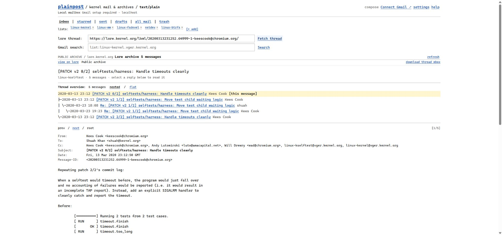
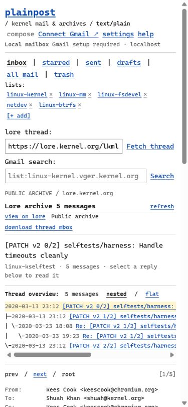

# Windows Chrome verification

Checked on 6 October 2026 using the Chrome browser extension, with the server running in Ubuntu WSL2. Windows Chrome accessed `http://localhost:4819` through WSL localhost forwarding. The temporary viewport override was restored after testing.

| Check | Result |
| --- | --- |
| Windows browser accessing the WSL server | Passed |
| Gmail setup dialog without credentials | Clear setup instructions, correct localhost callback, disabled sign-in until configured |
| Live lore import without Gmail login | Five messages loaded from the example below |
| Nested / flat thread view and selected-message headers | Passed; branches follow reply headers |
| Selected lore reply after page reload | Preserved |
| Keyboard message navigation and shortcut help | Passed |
| Reply all to the selected demo message | Correct recipient, list Cc, quotes and `In-Reply-To`; demo send appeared beneath the selected parent |
| Draft save, tab resume and server-backed draft reopening | Passed; tabs, trailing spaces and Unicode retained |
| Patch editing | Tab inserts a literal tab; sign-off appears before the patch separator; Ctrl+Enter opens send review |
| Demo search, starred folder, trash and restore | Passed; restored conversation reappeared in inbox |
| Unsupported archive URL | Rejected with a readable notification; the imported thread remained visible |
| 390 × 844 layout | Reader and composer fit; tree and patch text scroll within their own containers |
| Browser console | No warnings or errors recorded during the completed checks |
| Automated regression suite | 30/30 passed on Windows and 30/30 passed in Ubuntu WSL |

Live archive example: <https://lore.kernel.org/lkml/20200313231252.64999-1-keescook@chromium.org/>.

Mail transport normalizes line endings to CRLF and adds a final newline when necessary. Draft reopening retains the text content and spacing with that transport newline. Automated checks also cover MIME handling, raw/mbox exports, OAuth state/PKCE, token refresh, CSRF, send deduplication and headless service generation.

Browser testing found and fixed misleading Gmail readiness and draft status labels. Reopening a saved draft now shows its correct provider rather than immediately appearing edited. Demo discard notifications name the demo mailbox.

Real Gmail authentication, mailbox reads and sending remain unverified because account credentials are not configured. All browser sends used the isolated demo; no external email was sent. Physical Raspberry Pi / BeaglePlay testing remains unverified; Linux startup and tests ran in WSL, and ARM64 CI is configured separately.

## IMAP/SMTP update (6 October 2026)

The default login now reads a private Mutt-style home config and checks Gmail IMAP and SMTP with an app password. Google Cloud setup is optional. All 40 automated tests and standalone startup checks passed on Windows and Ubuntu WSL, including home permissions, SMTP bytes/Bcc, IMAP threading/pagination, drafts and account changes. The WSL sample was created with mode 600. These mail tests use mocked servers.

Chrome was closed during this update, so the revised setup dialog has not yet received a fresh Chrome visual check. Earlier screenshots cover the reader and demo flows above, not the new login dialog.

